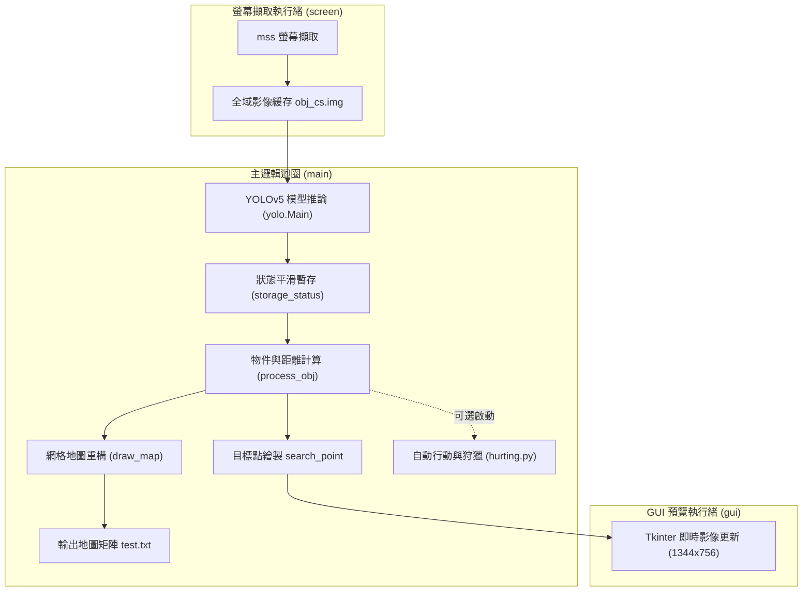

# 基於 YOLOv5 的 MapleStory 智能遊玩輔助系統 (研究與原型)

本專案為早期的概念驗證與研究專案（Proof of Concept），主要探討結合 **電腦視覺（Computer Vision）** 與 **即時自動化決策** 來實現《新楓之谷》（MapleStory）的自動遊玩與狀態感知系統。

專案以 `main.py` 為核心執行入口，透過即時螢幕擷取、YOLO 物件偵測（辨識玩家、怪物、地形、梯子）、空間座標離散化網格地圖重構，並具備即時 GUI 預覽與基礎自動狩獵控制能力。

---

## 📌 模型來源致謝

本專案所使用的 YOLOv5 目標辨識權重檔（`model/weights.pt`）來源於開源專案：
- **來源倉庫**：[TinForge/MS-ML-Bot](https://github.com/TinForge/MS-ML-Bot)
- 感謝原作者提供訓練完成的楓之谷遊戲元素識別模型。

---

## 🚀 核心功能與特色（以 `main.py` 為主）

1. **高速畫面截取（Multi-threaded Screen Capture）**
   - 使用 `mss` 套件進行高幀率螢幕擷取，支援多螢幕選取（於 `setting.py` 中配置）。
   - 獨立執行緒運作，不阻塞主分析與 GUI 迴圈。

2. **YOLOv5 即時目標檢測與分類**
   - 載入 `model/weights.pt` 進行即時物件偵測。
   - 偵測目標包含：**玩家（Player）**、**怪物（Monster）**、**地面/平台（Ground）**、**繩索/梯子（Ladder）**。
   - 具備狀態緩存機制（`storage_status.py`），防止因單幀辨識漏檢而造成追蹤閃爍。

3. **空間相對位置計算與目標鎖定**
   - 自動提取物件中心座標，計算玩家與各怪物之間的歐幾里得距離（Euclidean Distance）。
   - 即時鎖定「最近的目標怪物」，並於畫面視覺化標記（紅色圓點代表目標怪物、藍色圓點代表玩家）。

4. **遊戲世界網格離散化（Grid Map）**
   - 透過 `draw_map.py` 將 1920×1080 螢幕座標以 11×11 像素為單元進行降維與離散化，重構為 $175 \times 99$ 的二維狀態矩陣（`0: 空白, 1: 地板, 2: 繩索, 3: 玩家, 4: 怪物`）。
   - 矩陣即時輸出至 `test.txt`，可直接作為後續路徑規劃演算法（A*）或強化學習（RL / DQN）的狀態輸入（State Space）。

5. **即時 GUI 視覺化視窗**
   - 基於 Tkinter 與 PIL 構建，透過非同步排程（`after`）即時更新 1344×756 預覽畫面。

6. **自動狩獵與行動決策（Hurting/Hunting 模組）**
   - 根據水平（X）與垂直（Y）距離門檻，判斷是否處於可攻擊範圍。
   - 自動判斷怪物方向並轉向（面對左/右）。
   - 模擬鍵盤指令（攻擊鍵 `z`、移動鍵等），按鍵時加入微量隨機延遲（`random.uniform`）避免被行為偵測。

---

## 🛠️ 系統架構流程圖



---

## 📁 專案目錄結構說明

本專案保留了部分先前研究時進行模型訓練與演算法嘗試的過渡檔案，核心運作檔案與測試檔案分類如下：

```plaintext
.
├── main.py                    # 【核心】系統主程式入口（多執行緒排程、主迴圈）
├── setting.py                 # 【核心】系統設定檔（螢幕號碼、OCR 區域座標等）
│
├── function/                  # 【核心功能模組庫】
│   ├── capture_screen.py      # 螢幕畫面截取與 OCR 數值讀取模組
│   ├── process_obj.py         # YOLO 檢測結果過濾、中心點與距離計算
│   ├── draw_map.py            # 將物件座標轉換為離散化 2D 矩陣地圖
│   ├── hurting.py             # 狩獵行動決策、鍵盤按鍵控制
│   ├── storage_status.py      # 物件狀態暫存（避免偵測漏幀）
│   ├── keyboard.py            # PyAutoGUI 鍵盤操作輔助工具
│   ├── reward.py              # EXP 差值獎勵計算（RL 實驗用）
│   ├── window/
│   │   └── main.py            # Tkinter 即時畫面更新視窗
│   └── yolo/
│       └── main.py            # YOLOv5 權重載入與影像推論包裝
│
├── model/                     # 模型權重與結構定義
│   ├── weights.pt             # 【核心】YOLOv5 預訓練模型（來源：MS-ML-Bot）
│   ├── DQN_model.py           # 深度強化學習（DQN）網路結構（早期實驗階段）
│   ├── yolo11n.pt             # 額外測試模型權重
│   └── yolov8n.pt             # 額外測試模型權重
│
├── dataset/                   # 資料集與測試影像（早期標註與測試用）
├── dataset.yaml               # YOLO 資料集設定檔
│
└── [其他歷史/實驗檔案]
    ├── test.ipynb             # 早期實驗與驗證 Notebook
    ├── yolo_test.py           # YOLOv8 / YOLOv5 辨識測試腳本
    ├── yolo_model_test.py     # 模型資訊檢查腳本
    ├── yolo_test.ipynb        # 影像推論測試 Notebook
    └── model_info.txt         # 匯出的模型結構資訊
```

---

## ⚙️ 環境建置與安裝

建議使用 Python 3.8 ~ 3.10 環境，並安裝 PyTorch（建議安裝支援 CUDA 的 GPU 版本以保證辨識幀率）。

### 1. 安裝必要依賴套件

```bash
pip install torch torchvision --extra-index-url https://download.pytorch.org/whl/cu118
pip install opencv-python numpy pyautogui mss pillow
```

*(若需使用 YOLOv5 原生函式庫推論，需確認環境已具備 `yolov5` 或安裝 `ultralytics`)*：
```bash
pip install yolov5
```

*(可選功能)* 若要使用 `capture_screen.py` 中的角色血量/經驗值 OCR 功能：
- 下載並安裝 [Tesseract-OCR](https://github.com/UB-Mannheim/tesseract/wiki)
- 安裝 Python 介面：`pip install pytesseract`
- 於 `setting.py` 確認 `tesseract_dir` 安裝路徑。

---

## 🎮 使用與執行說明

### 1. 配置設定 (`setting.py`)

在啟動前，請依照您的遊戲顯示環境修改 `setting.py`：

```python
# 選擇要擷取的螢幕編號（若為雙螢幕/多螢幕，請設定 1 或 2）
screen_number = 2

# （可選）Tesseract OCR 執行檔路徑
tesseract_dir = r'C:\Program Files\Tesseract-OCR\tesseract.exe'

# （可選）HP/MP/EXP 於遊戲畫面上的截圖座標範圍 [ymin, ymax, xmin, xmax]
value_coordinate = {
    'hp': [969, 989, 520, 564],
    'mp': [969, 989, 746, 784],
    'exp': [969, 989, 1012, 1076],
}
```

### 2. 啟動系統

確保遊戲畫面置於設定的螢幕上，執行以下指令：

```bash
python main.py
```

### 3. 執行效果

- **Tkinter 預覽視窗**：會即時顯示縮放後的遊戲畫面，並以綠色邊框框出所有辨識到的平台、怪物與玩家；鎖定的最近怪物會標記紅色圓點，玩家本身會標記藍色圓點。
- **地圖矩陣**：系統每個循環會在根目錄生成 `test.txt`，記錄當前地圖的離散化佈局。
- **終端機輸出**：即時輸出每個循環之推論與處理耗時。

> **提示**：若欲啟用自動攻擊與移動行為，可至 `main.py` 的第 105~108 行解除註解：
> ```python
> # 狩獵
> try:
>     obj_hunting.main(map=corrent_map, obj=result)
> except:
>     None
> ```

---

## ⚠️ 免責聲明（Disclaimer）

- 本專案僅供**學術研究、計算機視覺技術探索與個人學習交流用途**。
- 請勿將本程式用於任何違反遊戲官方服務條款（Terms of Service）或破壞遊戲公平性之行為。
- 因使用本專案引發之任何帳號風險或衍生問題，使用者需自行承擔責任。
